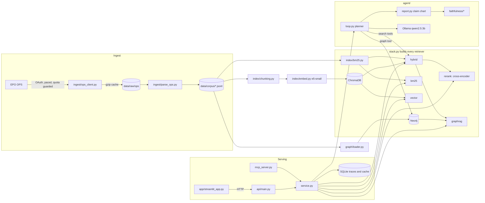
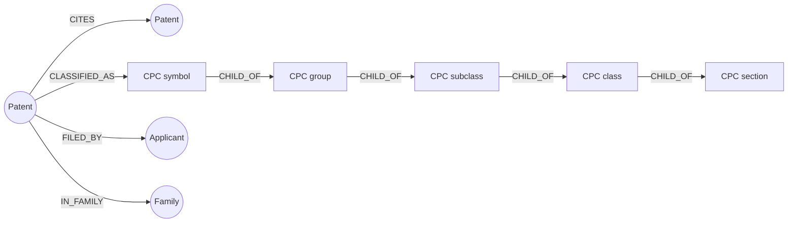
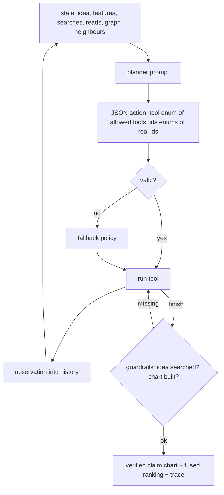

# Architecture

This document matches the code in `src/patentrag/`. Module paths are relative to that directory.

## Components

## Graph model

Constraints on `Patent.pub_id`, `CPC.id`, `Applicant.name`, `Family.family_id` are created before loading. Loading is batched `UNWIND ... MERGE`, so it is idempotent. After a load, `patentrag build-graph` compares database counts with counts derived from the corpus (`graph/schema.py: plan_graph`) and fails if they differ.

## Retrieval

Every retriever implements `search(query, k, exclusion) -> list[Hit]` (`retrieval/base.py`).

* `retrieval/lexical.py`: BM25 over title, abstract and claims.
* `retrieval/vector.py`: e5 chunk embeddings, patent score = best chunk.
* `retrieval/hybrid.py`: `LexicalVectorScores` computes the exact vector similarity of every patent (one matrix product over all chunk vectors) and the BM25 score of every patent, builds the pool (vector top 100 plus BM25 top 100), min-max normalises both scores with the pool's range, and ranks the pool by `w_sim * sim + w_bm25 * bm25`.
* `retrieval/reranker.py`: re-scores the hybrid top `depth` with a cross-encoder and blends `alpha * ce + (1 - alpha) * base`; later results keep their order.
* `retrieval/graphrag.py`: hybrid seeds, CPC vote, candidates from the text pool plus the CPC subtree, citation neighbours and family of the seeds, then a weighted re-rank (`sim`, `bm25`, CPC overlap, citation vote, family, applicant). With every graph signal off it ranks exactly like `hybrid` (tested).
* `stack.py`: builds all of the above once, with the parameters tuned on validation queries (`evaluation/params.py` reads `results/tuned_params_<scope>.json`). `best()` returns hybrid, or hybrid plus re-ranking if that won on validation.

## Agent

`agent/loop.py`. Tools: `search_idea`, `extract_features`, `search_feature`, `read_patent`, `graph_neighbours`, `claim_chart`, `finish`. The planner is `qwen2.5:3b-instruct` through Ollama with a JSON schema (`format`), so the action is always well formed; the schema is rebuilt every step so it offers only the tools that make sense now, and it has one id field per tool whose enum holds only the ids valid for that tool (unread candidates for `read_id`, unexpanded ones for `expand_id`). Reads and graph expansions are capped (`max_reads`, `max_expansions`). Semantically invalid actions (a feature already searched, a patent already read, no id) are replaced by the fallback policy and recorded with the reason. Guardrails: at most `max_steps` steps; no finish without a whole-idea search; in report mode no finish without a claim chart. Every step is stored with its source (`planner`, `fallback`, `guardrail`), arguments, observation and time.

The agent's ranking fuses its searches by weighted reciprocal rank (whole idea weight 1, each feature `feature_weight`, chosen on validation queries).

## Claim chart and checks

`agent/report.py`:

1. `extract_features`: 2 to 5 features of the idea (JSON list), cleaned and deduplicated.
2. `candidate_sentences`: the text of each charted patent (title, abstract, first independent claim; `index/chunking.py: source_text`) is split into sentences, and for each feature they are ranked by cosine similarity with the retrieval embedding model (`embedding_ranker`, multilingual-e5).
3. Every feature and patent pair gets its best-ranked sentence as a row (`build_chart`). Evidence is always a sentence of the cited patent's own text, so quotes and patent numbers cannot be invented.
4. Checks: `faithfulness/citations.py` (every patent number was retrieved; every evidence sentence occurs in the cited patent's own text); `faithfulness/judge.py` (each feature against the idea, each row's feature against its evidence sentence, by the LLM judge and the NLI cross-encoder; a statement is supported only if both agree).
5. A rejected row is retried with the next-ranked sentence, up to `max_retries` times; `mark_and_prune` keeps only verified rows (whose feature is also supported by the idea) and counts the pairs left without evidence (`removed_rows`).

## Interfaces

* CLI `patentrag` (`cli.py`): `check-credentials`, `fetch`, `build-corpus`, `build-graph`, `build-index`, `tune`, `tune-agent`, `evaluate`, `ablate`, `robustness`, `faithfulness`, `faith-audit`, `serve-mcp`, `serve-api`, `report`.
* MCP (`mcp_server.py`): `search_patents`, `run_prior_art_agent`, `get_agent_trace`; stdio or streamable HTTP.
* API (`api/main.py`): `/v1/health`, `/v1/ready`, `/v1/search`, `/v1/report` (agent, waits for the result), `/v1/report/jobs` and `/v1/report/jobs/{id}` (agent as a background job, for slow CPU runs), `/v1/trace/{id}`, `/metrics`.
* UI (`app/streamlit_app.py`): HTTP client of the API; submits agent runs as jobs and shows the claim chart next to the agent's steps.

## Where things run

* **Laptop (8 GB RAM, CPU)**: serving. Neo4j in Docker (1 GB heap, 512 MB page cache, 2.2 GB container limit), Ollama on the host, the API and UI from the venv or Docker. An agent run takes minutes on CPU.
* **GPU VM (Colab T4)**: the compute pipeline (`scripts/colab_setup.sh`, `scripts/pipeline.sh`): indexes, graph, tuning, evaluation, agent runs, audit. Results are copied back as compact, checksummed text (`scripts/export_results.py`, `scripts/import_results.py`).
